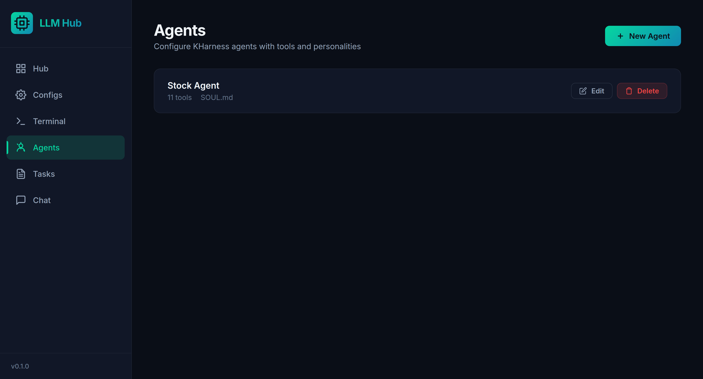
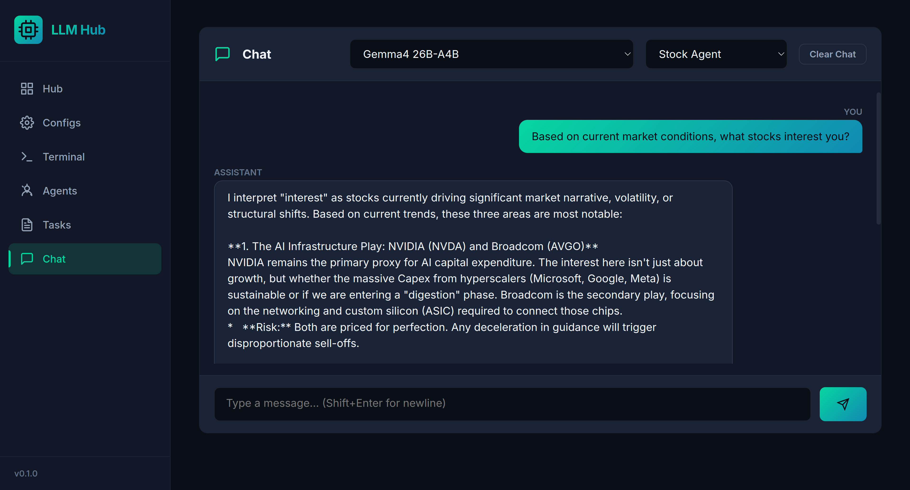
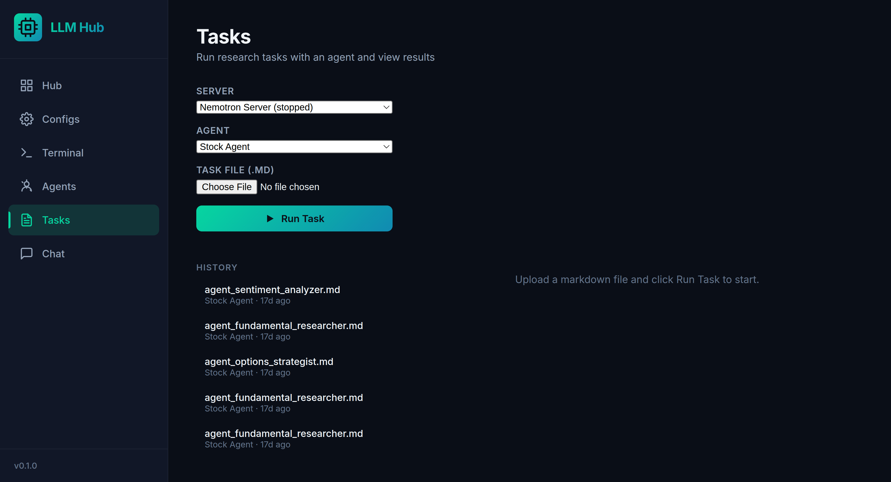

# LLM Hub

LLM Hub is a local web interface for managing `llama.cpp` model servers. It gives you one dashboard for saved `llama-server` configurations, process start/stop controls, live terminal output, chat, configurable tool-using agents, and longer-running research tasks.


## What It Does

- Saves reusable `llama-server` configurations for GGUF models.
- Starts and stops local `llama-server` processes from the browser.
- Detects already-running configured servers on startup when possible.
- Streams recent stdout and stderr from managed server processes.
- Provides plain chat against a running llama.cpp OpenAI-compatible endpoint.
- Supports named agents with selectable web and stock tools.
- Runs uploaded Markdown task instructions through an agent and stores completed reports.

## Screens

The hub is the control room. Each configured model appears as a card with its current status, address, model name, GPU layer setting, context size, and start/stop actions.


Server definitions live in the Configs page. A config maps a model path to a host, port, GPU layer count, context window, thread count, parallel slots, optional multimodal projector, and any extra `llama-server` flags you need.


When a managed process is running, the Terminal page lets you follow its output without leaving the browser. Output is retained for recently stopped managed servers so failed starts are easier to debug.


Agents add a reusable layer on top of a running model. You can give an agent a name, optionally point it at a `soul.md` file, and enable the tools it should be allowed to call.



The Chat page can talk directly to a running server or route the conversation through one of your configured agents. Plain chat keeps a small per-server conversation memory; agent chat keeps memory per server and agent pair.



For longer jobs, upload a Markdown task file, choose a running server and agent, and watch progress updates stream back while the final report is saved to history.



## Requirements

- Python 3.12 or newer.
- `llama-server` available on your `PATH`.
- A local GGUF model file for each server configuration you create.
- Optional: an `.mmproj` file for multimodal llama.cpp models.

LLM Hub shells out to `llama-server`, so install `llama.cpp` separately and confirm this works before starting a server from the UI:

```bash
llama-server --help
```

## Installation

Using `uv`:

```bash
uv sync
```

Using `pip`:

```bash
python -m venv .venv
source .venv/bin/activate
pip install -r requirements.txt
```

## Running

Start the FastAPI app:

```bash
python main.py
```

Then open:

```text
http://localhost:8005
```

The included `run.sh` does the same thing for this local checkout after activating `.venv`.

## Basic Workflow

1. Open `http://localhost:8005`.
2. Go to **Configs** and create a server configuration for a GGUF model.
3. Start the server from **Hub**.
4. Check **Terminal** if the process fails or you want to inspect logs.
5. Use **Chat** for direct model conversations.
6. Create an **Agent** when you want tool access or a reusable `soul.md`.
7. Use **Tasks** to upload Markdown instructions and save longer research outputs.

## Configuration

Saved server configs are stored in:

```text
llmhub/config.json
```

Each config includes:

- `name`: display name for the UI.
- `model_path`: absolute or relative path to a `.gguf` model.
- `host` and `port`: address passed to `llama-server`.
- `n_gpu_layers`: GPU offload count, with `-1` meaning all layers.
- `ctx_size`: context window size.
- `threads`: CPU thread count.
- `parallel`: concurrent request slots.
- `cont_batching`: whether to pass `--cont-batching`.
- `mmproj_path`: optional multimodal projector path.
- `extra_args`: additional CLI flags parsed with shell-like quoting.

Agent configs are stored in:

```text
llmhub/agents.json
```

Task history is stored in:

```text
llmhub/task_results.json
```

These JSON files are local runtime state. Back them up if you want to keep your configured servers, agents, or historical task reports.

## API Overview

LLM Hub exposes a small JSON API under `/api`:

- `GET /api/configs`
- `POST /api/configs`
- `GET /api/configs/{config_id}`
- `PUT /api/configs/{config_id}`
- `DELETE /api/configs/{config_id}`
- `POST /api/configs/{config_id}/start`
- `POST /api/configs/{config_id}/stop`
- `GET /api/configs/{config_id}/output`
- `POST /api/configs/{config_id}/chat`
- `POST /api/configs/{config_id}/chat/clear`
- `GET /api/agents`
- `POST /api/agents`
- `GET /api/agents/{agent_id}`
- `PUT /api/agents/{agent_id}`
- `DELETE /api/agents/{agent_id}`
- `POST /api/tasks/run`
- `GET /api/tasks/history`
- `GET /api/tasks/{run_id}/stream`

The task stream endpoint uses server-sent events.

## Development

Run the test suite with:

```bash
uv run pytest
```

or, inside an activated environment:

```bash
pytest
```

Project layout:

```text
llmhub/
  server.py            FastAPI app and routes
  process_manager.py   llama-server subprocess management
  config_manager.py    server config persistence
  agent_manager.py     agent config persistence
  chat.py              llama.cpp chat and agent wiring
  task_runner.py       background task runs and SSE streaming
ui/
  index.html           SPA shell
  app.js               client-side routing and API calls
  styles.css           UI styles
assets/screenshots/    README screenshots
tests/                 route and manager tests
```

## Notes

- Stopping a server only terminates processes that LLM Hub started. If a matching server was detected as already running at startup, LLM Hub untracks it instead of killing it.
- Configs cannot be edited or deleted while their server is running.
- Chat requires a running server because requests are sent to the configured llama.cpp `/v1/chat/completions` endpoint.
- The app is intended for local, trusted use. It does not implement authentication.
