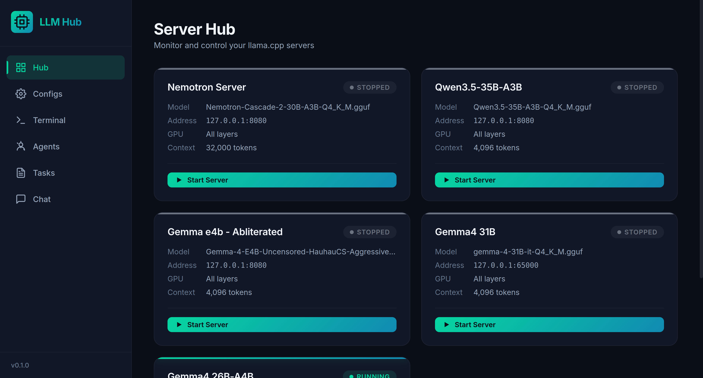
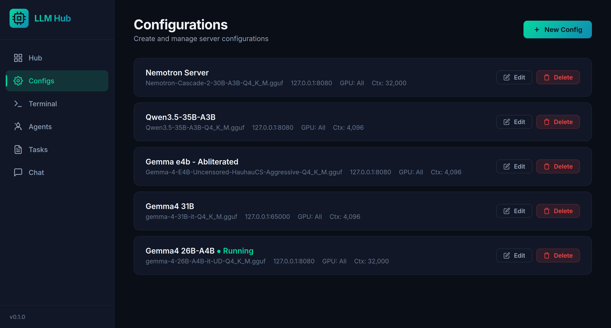
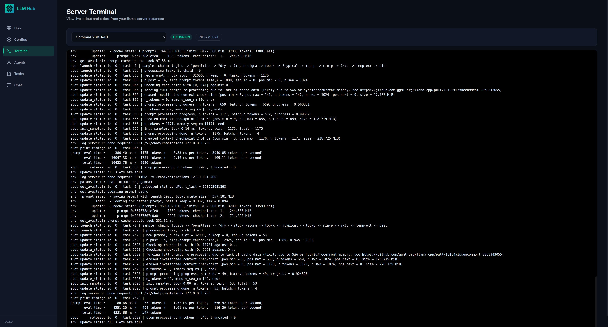

# LLM Hub

LLM Hub is a local web interface for configuring and managing `llama.cpp` model servers. It provides saved `llama-server` configurations, health/status monitoring, process start/stop/restart controls, model discovery, startup adoption of already-running configured servers, and recent terminal output from managed processes.



## What It Does

- Saves reusable `llama-server` configurations for GGUF models.
- Validates model paths, ports, numeric settings, `.mmproj` paths, and extra argument syntax.
- Starts, stops, and restarts local `llama-server` processes from the browser.
- Detects already-running configured servers on startup when possible.
- Shows health states: healthy, loading, unreachable, and stopped.
- Tracks startup elapsed time, readiness, exit codes, and recent failure summaries.
- Detects port conflicts before starting a managed server.
- Suggests free ports for new configs.
- Scans local directories for `.gguf` and `.mmproj` files with a preview table before creating configs.
- Provides presets for CPU, CUDA full offload, large context, vision, and low VRAM configs.
- Saves app defaults for new configs, scanner base paths, refresh interval, and terminal retention.
- Supports per-server environment variables and structured advanced flags.
- Shows model file size, filesystem warnings, and simple memory/resource hints.
- Shows command previews and one-click command/server URL copying.
- Supports config duplicate, JSON import, and JSON export.
- Exports individual configs and imports either one config, an array, or a wrapped `{configs: [...]}` export.
- Tests the OpenAI-compatible `/v1/models` endpoint for a running config.
- Runs a quick `/v1/chat/completions` benchmark for configured endpoints.
- Tracks input and output token totals per config for benchmarks and requests sent through LLM Hub's OpenAI-compatible proxy routes.
- Estimates per-config token spend from tracked usage and user-supplied input/output prices.
- Provides a lightweight chat page for sending test messages to a selected config.
- Shows best-effort system RAM telemetry and GPU telemetry from `nvidia-smi` or `rocm-smi` when available.
- Streams, filters, annotates, copies, downloads, and clears retained stdout/stderr from managed server processes.

## Screens

The hub is the control room. Each configured model appears as a card with its current status, address, model name, GPU layer setting, context size, and start/stop actions.


When telemetry is available, the Hub page also shows system memory and GPU cards so you can see VRAM, utilization, temperature, and power data before starting or tuning a server.

Server definitions live in the Configs page. A config maps a model path to a host, port, GPU layer count, context window, thread count, parallel slots, optional multimodal projector, and any extra `llama-server` flags you need.



When a managed process is running, the Terminal page lets you follow its output without leaving the browser. Output is retained for recently stopped managed servers so failed starts are easier to debug.



## Requirements

- Python 3.12 or newer.
- `llama-server` available on your `PATH`.
- A local GGUF model file for each server configuration you create.
- Optional: an `.mmproj` file for multimodal llama.cpp models.
- Optional: `nvidia-smi` or `rocm-smi` for GPU telemetry.

LLM Hub shells out to `llama-server`, so install `llama.cpp` separately and confirm this works before starting a server from the UI:

```bash
llama-server --help
```

## Installation

Using `uv`:

```bash
uv sync
```

Using `pip`:

```bash
python -m venv .venv
source .venv/bin/activate
pip install -r requirements.txt
```

## Running

Start the FastAPI app:

```bash
python main.py
```

Then open:

```text
http://localhost:8005
```

The included `run.sh` does the same thing for this local checkout after activating `.venv`.

To install a shell alias so you can start the app with `hub`:

```bash
./alias.sh
source ~/.bashrc
```

If you use zsh, source `~/.zshrc` instead. The installer detects bash/zsh from `$SHELL`, updates the matching rc file, and replaces its own managed alias block if you run it again.

You can choose a different alias name by passing it as the first argument:

```bash
./alias.sh llmhub
```

## Basic Workflow

1. Open `http://localhost:8005`.
2. Go to **Configs** and create a server configuration for a GGUF model.
3. Start the server from **Hub**.
4. Check **Terminal** if the process fails or you want to inspect logs.
5. Duplicate or export configs when you want to try variants or back up your setup.
6. Use **Scan Models** or **Find free port** to reduce manual config work.
7. Adjust **Settings** when you want new configs and scans to use different defaults.

## Configuration

Saved server configs are stored in:

```text
llmhub/config.json
```

App settings are stored in:

```text
llmhub/settings.json
```

Token usage counters are stored in:

```text
llmhub/token_usage.json
```

Set `LLMHUB_DATA_DIR` to store runtime config outside the package directory:

```bash
LLMHUB_DATA_DIR=/path/to/llmhub-data python main.py
```

When `LLMHUB_DATA_DIR` is set, both `config.json` and `settings.json` are written in that directory instead of under `llmhub/`.
Token usage is also written there as `token_usage.json`.

Each config includes:

- `name`: display name for the UI.
- `model_path`: absolute or relative path to a `.gguf` model.
- `host` and `port`: address passed to `llama-server`.
- `n_gpu_layers`: GPU offload count, with `-1` meaning all layers.
- `ctx_size`: context window size.
- `threads`: CPU thread count.
- `parallel`: concurrent request slots.
- `cont_batching`: whether to pass `--cont-batching`.
- `mmproj_path`: optional multimodal projector path.
- `extra_args`: additional CLI flags parsed with shell-like quoting.
- `advanced_args`: structured extra `llama-server` flags, one flag/token per entry.
- `env_vars`: environment variables passed only to this server process.
- `preset`: optional preset identifier used to seed common settings.
- `created_at`, `updated_at`, `last_started_at`, `last_used_at`: local metadata for sorting and display.
- `schema_version`: config schema marker used for local migrations.

App settings include default host, base port, GPU layers, context size, threads, parallel slots, preset, model scan directory, refresh interval, and retained terminal log lines. These defaults seed newly-created configs and scanner-generated configs; existing configs are not modified.

## API Overview

LLM Hub exposes a small JSON API under `/api`:

- `GET /api/configs`
- `POST /api/configs`
- `GET /api/presets`
- `GET /api/gpus`
- `GET /api/ram`
- `GET /api/settings`
- `PUT /api/settings`
- `GET /api/ports/free`
- `GET /api/models/scan`
- `GET /api/configs/export`
- `POST /api/configs/import`
- `GET /api/configs/{config_id}`
- `GET /api/configs/{config_id}/export`
- `PUT /api/configs/{config_id}`
- `DELETE /api/configs/{config_id}`
- `POST /api/configs/{config_id}/duplicate`
- `POST /api/configs/{config_id}/start`
- `POST /api/configs/{config_id}/stop`
- `POST /api/configs/{config_id}/restart`
- `GET /api/configs/{config_id}/output`
- `POST /api/configs/{config_id}/output/clear`
- `GET /api/configs/{config_id}/logs`
- `GET /api/configs/{config_id}/command`
- `GET /api/configs/{config_id}/tokens`
- `POST /api/configs/{config_id}/tokens/reset`
- `GET|POST /api/configs/{config_id}/v1/{path}` (OpenAI-compatible proxy, including `/v1/chat/completions`, `/v1/completions`, and `/v1/models`)
- `POST /api/configs/{config_id}/benchmark`
- `POST /api/configs/{config_id}/test`

Token tracking is exact when the proxied llama.cpp response includes the standard OpenAI-compatible `usage` object. Streamed responses are counted when the final stream chunk carries a `usage` object (llama.cpp includes it when clients request `stream_options: {"include_usage": true}`). Direct calls to the raw llama-server URL bypass LLM Hub and are not counted.

## Development

Run the test suite with:

```bash
uv run pytest
```

or, inside an activated environment:

```bash
pytest
```

Project layout:

```text
llmhub/
  server.py            FastAPI app and routes
  process_manager.py   llama-server subprocess management
  config_manager.py    server config persistence
  settings_manager.py  app defaults and UI settings persistence
  gpu_monitor.py       best-effort NVIDIA/AMD GPU telemetry
  ram_monitor.py       best-effort system memory telemetry
  models.py            Pydantic request/response models
ui/
  index.html           SPA shell
  app.js               client-side routing and API calls
  styles.css           UI styles
assets/screenshots/    README screenshots
tests/                 route and manager tests
```

## Notes

- Stopping a server only terminates processes that LLM Hub started. If a matching server was detected as already running at startup, LLM Hub untracks it instead of killing it.
- Configs cannot be edited or deleted while their server is running.
- The app is intended for local, trusted use. It does not implement authentication.
